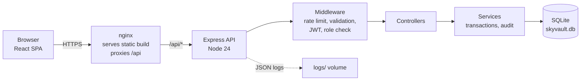

# SkyVault Bank

A full-stack digital banking application. Customers register, log in, view their balance, deposit, withdraw, transfer money to other accounts, and review their transaction history. Admins can view all users and the audit log.

> This is a learning and portfolio project, not a production banking system. Do not use real financial data with it.

## Table of contents

1. [What it does](#what-it-does)
2. [Architecture](#architecture)
3. [Technologies](#technologies)
4. [Project structure](#project-structure)
5. [Running it](#running-it)
6. [Deployment](#deployment)
7. [Security](#security)
8. [Monitoring and observability](#monitoring-and-observability)
9. [API reference](#api-reference)
10. [Known limitations and roadmap](#known-limitations-and-roadmap)

## What it does

| Feature | Description |
|---|---|
| Registration and login | Create a customer with a savings account; log in with email and password |
| Dashboard | Balance, masked account number, quick actions, recent transactions |
| Deposit and withdraw | Move money in and out of your own account |
| Transfer | Send money to another account number, with a review-then-confirm step |
| Transaction history | Filter by type, search by description, open a transaction for full details |
| Settings | Change your password |
| Admin API | List all users, accounts and audit log entries (role-restricted) |

Transaction rules enforced by the backend: the amount must be above zero, you cannot withdraw or transfer more than your balance, you cannot transfer to yourself, and the recipient account must exist and be active.

## Architecture



**Request path.** A page in the React app calls a service module, which uses a shared Axios client (`api.js`). The client attaches the JWT access token and, if it has expired, refreshes it and retries. In Docker, nginx serves the built frontend and forwards `/api/` requests to the backend container. In the API, each request passes through middleware (rate limiting, validation, authentication, role checks), then a controller, then a service that applies the business rules and talks to SQLite through the model layer.

**Atomic money movement.** Deposit, withdraw and transfer each run inside a single database transaction. A transfer debits one account, credits the other, and writes two transaction rows, or it changes nothing.

**Audit trail.** Controllers record security-relevant events (login, failed login, deposit, withdraw, transfer, password change, account lock) to an `audit_logs` table with user, action, status, IP address and user agent.

**Data model.** Four tables: `users`, `accounts`, `transactions`, `audit_logs`. Money is stored as integer paise (Rs 85,500 is saved as `8550000`) to avoid floating-point errors.

## Technologies

| Layer | Technology |
|---|---|
| Frontend | React 19, Vite 8, React Router 7, Tailwind CSS v4, Axios |
| Backend | Node.js 24, Express |
| Database | SQLite via `better-sqlite3` (swappable for PostgreSQL) |
| Auth | JWT access and refresh tokens, bcrypt password hashing |
| Validation and hardening | express-validator, helmet, express-rate-limit, cors |
| Logging | winston (JSON logs), morgan (HTTP access logs) |
| Testing | Jest, Supertest |
| Containers | Docker multi-stage builds, Docker Compose, nginx |
| CI/CD | GitHub Actions, GitHub Container Registry (GHCR) |
| Scanning | npm audit, Trivy (images), gitleaks (secrets) |

## Project structure

```
skyvault-bank/
├── backend/
│   ├── src/
│   │   ├── config/        # SQLite connection and schema (db.js)
│   │   ├── routes/        # /api/auth, /accounts, /transactions, /admin
│   │   ├── middleware/    # auth + RBAC, validators, rate limiter, error handler
│   │   ├── controllers/   # request handlers
│   │   ├── services/      # transactionService, auditService
│   │   ├── models/        # data access (users, accounts, transactions)
│   │   ├── utils/         # JWT/bcrypt helpers, money helpers, logger, seed script
│   │   ├── app.js         # Express app
│   │   └── server.js      # entry point
│   ├── tests/             # Jest + Supertest integration tests
│   ├── Dockerfile
│   └── VULNERABILITIES.md # intentional audit findings (see Security)
├── frontend/
│   ├── src/
│   │   ├── pages/         # Login, Register, Dashboard, Transfer, History, ...
│   │   ├── components/    # Layout, Input, Button, Alert, ProtectedRoute
│   │   ├── context/       # AuthContext
│   │   ├── services/      # Axios client and per-resource API modules
│   │   └── utils/         # formatting helpers
│   ├── index.html
│   ├── vite.config.js
│   ├── nginx.conf
│   └── Dockerfile
├── .github/workflows/     # ci.yml, cd.yml
└── docker-compose.yml
```

## Running it

Requires Node.js 24 or newer. For the Docker route you need Docker with the Compose plugin.

### Option 1: Docker Compose

```bash
export JWT_SECRET="a-long-random-string"
export JWT_REFRESH_SECRET="a-different-long-random-string"
docker compose up --build
```

| Service | URL |
|---|---|
| App | http://localhost:3000 |
| API | http://localhost:5000/api |
| Health check | http://localhost:5000/health |

Load the demo users into the container's database:

```bash
docker compose exec backend node src/utils/seed.js
```

### Option 2: Local development

```bash
# Backend (http://localhost:5000)
cd backend
cp .env.example .env      # then set JWT_SECRET and JWT_REFRESH_SECRET
npm install
npm run seed              # creates the demo users
npm run dev

# Frontend (http://localhost:3000), in a second terminal
cd frontend
cp .env.example .env
npm install
npm run dev
```

### Demo accounts

| Role | Email | Password |
|---|---|---|
| Admin | admin@skyvault.bank | Admin@12345 |
| Customer | demo@skyvault.bank | Demo@12345 |

These exist only for local testing. The seed script prints the demo customer's account number. Never seed them on a public deployment.

### Tests and checks

```bash
cd backend
npm test                  # Jest + Supertest
npm run test:coverage
npm run lint

cd ../frontend
npm run lint
npm run build
```

## Deployment

### Containers

- **Backend image:** `node:24-alpine`, multi-stage. The build stage compiles `better-sqlite3`; the runtime stage runs as a non-root user under `tini` and has a `HEALTHCHECK` on `/health`.
- **Frontend image:** `node:24-alpine` builds the Vite app, then `nginx:1.27-alpine` serves the static files and proxies `/api/` to the backend.
- **Compose:** `docker-compose.yml` starts both. The frontend waits for the backend health check to pass. A named volume (`skyvault-data`) keeps the SQLite file across restarts and rebuilds; `skyvault-logs` keeps the log files.

### CI/CD pipeline (GitHub Actions)

| Workflow | Trigger | What it does |
|---|---|---|
| `ci.yml` | Push or PR to `main` / `develop` | Backend lint and Jest with coverage; frontend production build; `npm audit` on both apps; gitleaks secret scan; Docker image build; Trivy scan of both images |
| `cd.yml` | Push to `main`, or a `v*.*.*` tag | Builds both images and pushes them to `ghcr.io`, tagged by commit SHA, branch and semantic version; then runs a deploy job |

The workflows cache dependencies using `package-lock.json`, so commit the lock files for `backend/` and `frontend/`.

### Live environment

The `deploy` job in `cd.yml` is a placeholder. A typical target is a single VM running Docker Compose, where the job connects over SSH and runs:

```bash
docker compose pull && docker compose up -d
```

<!-- Fill this in for your own deployment: -->
- **Where it runs:** _host / provider_
- **URL:** _https://your-domain_
- **How the deploy job connects:** _SSH key stored as a GitHub secret, or your platform's deploy hook_
- **TLS:** _how HTTPS is terminated (reverse proxy, load balancer, platform)_

## Security

**Authentication and authorization**
- Passwords are hashed with bcrypt (12 rounds) and must be at least 8 characters with upper case, lower case and a digit.
- Access tokens are short-lived JWTs (15 minutes); refresh tokens last 7 days.
- Role-based access control: `CUSTOMER` and `ADMIN`. Admin routes sit behind an `authorize('ADMIN')` check, and customers can only read or move money from accounts they own.
- An account is locked after 5 failed logins.

**API hardening**
- `helmet` security headers, CORS limited to the configured frontend origin, JSON body size limit of 10 kb.
- Rate limiting: 100 requests per 15 minutes per client in general, 5 per 15 minutes on `/auth/login`.
- Input validation on every write endpoint; all database access uses prepared statements, so user input is never concatenated into SQL.
- Error responses hide internals in production.

**Financial integrity**
- Integer money storage, atomic database transactions, and validation of every rule listed under [What it does](#what-it-does).

**Container and pipeline security**
- Non-root container user, multi-stage builds, minimal Alpine base images, secrets passed through environment variables and never baked into images.
- CI gates: `npm audit` fails the build on high or critical findings, gitleaks scans for committed secrets, and Trivy fails the build on fixable critical or high image vulnerabilities.

**Intentional dependency findings.** The backend pins `express` at exactly `4.19.2` so that `npm audit` reports two real moderate-severity advisories (`path-to-regexp` ReDoS, CVE-2024-45296, and a `body-parser` denial of service). This is for practicing detect, investigate, remediate and verify in a pipeline. See [`backend/VULNERABILITIES.md`](backend/VULNERABILITIES.md). To see them, run `npm audit --audit-level=moderate` (the CI gate is set to `high`, so it does not fail on them). To fix them, upgrade Express to 4.20.0 or newer. The frontend is kept on current packages and is expected to report none; run `npm audit` after `npm ci` to confirm.

## Monitoring and observability

What is in place:

| Signal | Where |
|---|---|
| Health endpoint | `GET /health` returns status, service name and timestamp |
| Container health | Docker `HEALTHCHECK` on both images; Compose gates the frontend on the backend |
| Application logs | winston writes JSON to `backend/logs/combined.log` and `error.log` (volume `skyvault-logs`); console output in development |
| HTTP access logs | morgan, forwarded into the winston log |
| Audit trail | `audit_logs` table, readable by admins at `GET /api/admin/audit-logs` |
| Failed-login visibility | `FAILED_LOGIN` and `ACCOUNT_LOCKED` events in the audit log |

Useful commands:

```bash
docker compose ps                         # health status of both services
docker compose logs -f backend            # live application and access logs
curl http://localhost:5000/health
```

Not included yet: metrics (for example Prometheus and Grafana), alerting, centralized log shipping, and an admin dashboard in the UI. These are the natural next steps.

## API reference

| Method | Endpoint | Auth | Description |
|---|---|---|---|
| POST | `/api/auth/register` | none | Create a customer and a savings account |
| POST | `/api/auth/login` | none | Returns access and refresh tokens |
| POST | `/api/auth/refresh` | none | Exchange a refresh token for a new access token |
| POST | `/api/auth/logout` | JWT | Records the logout in the audit log |
| POST | `/api/auth/change-password` | JWT | Change password |
| GET | `/api/auth/me` | JWT | Current user |
| GET | `/api/accounts/dashboard` | JWT | Balance and recent transactions |
| GET | `/api/accounts` | JWT | Your accounts |
| GET | `/api/accounts/:id` | JWT | One account (owner or admin) |
| GET | `/api/accounts/all` | JWT, ADMIN | All accounts |
| POST | `/api/transactions/deposit` | JWT | Deposit into your account |
| POST | `/api/transactions/withdraw` | JWT | Withdraw from your account |
| POST | `/api/transactions/transfer` | JWT | Transfer to another account number |
| GET | `/api/transactions/account/:accountId` | JWT | History, filterable by `type` |
| GET | `/api/transactions/:id` | JWT | Transaction details |
| GET | `/api/admin/users` | JWT, ADMIN | All users |
| GET | `/api/admin/audit-logs` | JWT, ADMIN | Audit log |
| GET | `/health` | none | Health check |

## Known limitations and roadmap

- Tokens are kept in `localStorage`, which is exposed to any cross-site scripting bug. Httponly cookies would be safer.
- Logout is stateless: the server records it but does not revoke tokens, and refresh tokens are not rotated.
- The default JWT secrets in `docker-compose.yml` are placeholders and must be overridden.
- Locked accounts have no self-service unlock.
- SQLite is single-node and file-based. Use PostgreSQL for anything beyond a demo.
- Planned: multiple accounts per user, beneficiaries, pagination, statement download, password reset, two-factor authentication, transaction limits, fraud alerts, an admin dashboard, and metrics with alerting.

## License

MIT
